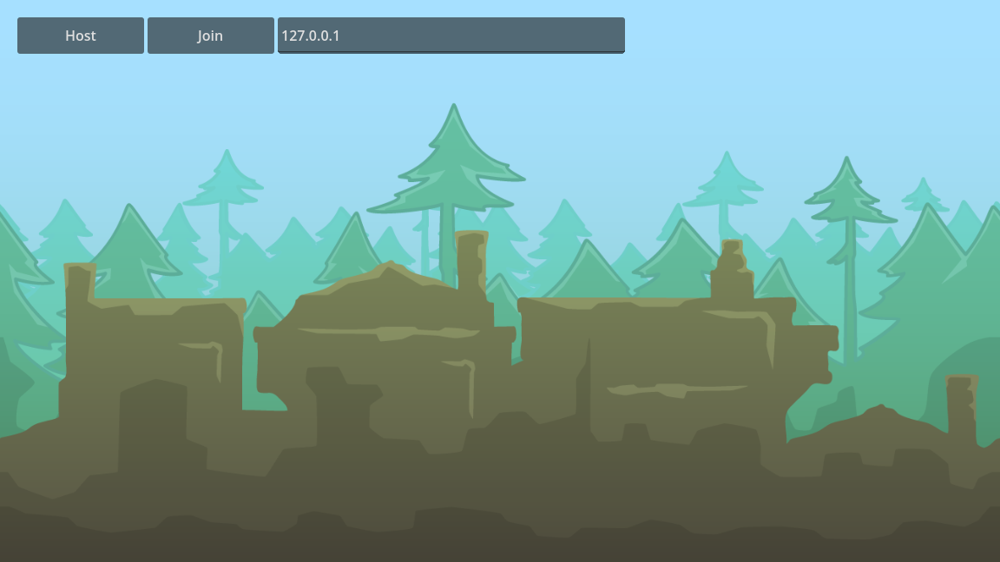
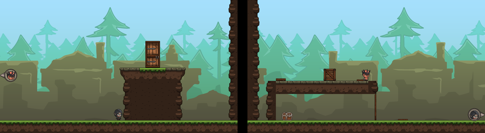

# godot-multiplayer

A two-player networked co-op puzzle platformer made in Godot. One player hosts, the other joins by IP address. Both players have to get through the level together.

Demo video: https://youtu.be/VgfsNQG_6ww

Built solo in October 2024.




## What the game is

Two characters (a knight and an elf) start in a 2D level. They work together to open doors, cross gaps and reach the exit.

- Pressure plates open doors. A plate counts as down while at least one body stands on it.
- A bridge only appears when two activators are pressed at once.
- A chest holds a key. Opening it spawns a key that follows the player.
- Bring the key to the key door to open the exit. Both players then have to go through the exit.
- Pushable crates can be shoved by the players.
- When a player is off screen, an arrow at the screen edge points to them.
- When all players have left through the exit, the level reloads. There is only one level so far.

## Networking

- Built on Godot's high-level multiplayer API with `ENetMultiplayerPeer`.
- The host runs the server on port 7000 and also plays. The server accepts at most 2 connections.
- `lobby.gd` is an autoload called `Lobby`. It creates or joins a game, keeps the player list, registers each player with a reliable RPC, and emits connect and disconnect signals.
- `MultiplayerSpawner` nodes spawn the level and the player scenes on every peer.
- `MultiplayerSynchronizer` nodes sync the state of the interactable objects (doors, plates, bridges, chests, the key door).
- Each player node is named after its peer id, and that peer has authority over it. Remote players are smoothed with an interpolation function in `helper_functions.gd`. The key uses the same function.
- The `interact` key sends an RPC to the server. The server decides what happens.
- If a peer disconnects, the server removes its player.

## Requirements

- Godot 4.3 (the project uses the Forward Plus renderer).

## How to run

1. Clone the repo and import `project.godot` in the Godot editor.
2. Press Play. The main scene is the menu. You can also run `godot --path .` from the repo folder. Under a headless or GPU-less setup, add `--rendering-driver opengl3`.

To test on one machine, run two instances. In the editor you can use Debug, then Run Multiple Instances.

### Host

1. Click **Host**. The label shows "Hosting!" and the buttons are replaced by **Start**.
2. Tell the other player your LAN IP address.
3. When they are connected, click **Start**.

### Join

1. Type the host's IP address in the text field. The default is `127.0.0.1` (the same machine).
2. Click **Join**. The label shows "Connecting..." and then "Successfully connected!". On failure it shows "Failed to connect".
3. Wait for the host to click Start.

The host must allow incoming connections on port 7000 (ENet uses UDP). The port is a constant in `lobby.gd`.

## Controls

| Action | Keyboard | Gamepad |
| --- | --- | --- |
| Move left | A or Left arrow | D-pad left |
| Move right | D or Right arrow | D-pad right |
| Jump (press again in the air to double jump) | W, Up arrow or Space | Bottom face button |
| Interact | E | Left face button |

Release the jump button early to cut the jump short.

## Project layout

```
project.godot            project settings and input map
lobby.gd                 autoload: host/join, player list, RPC registration
helper_functions.gd      position interpolation
levels/menu/             main menu: host, join, start, level switching
levels/level.gd          spawns players, tracks level completion
levels/level_01/         the one level
player/                  player script and scene, knight and elf variants,
                         camera, off-screen player finder arrow
interactables/           bridge, chest, door, key and key door,
                         pressure plate, pushable crate
art/                     backgrounds, characters, objects, platforms
```
